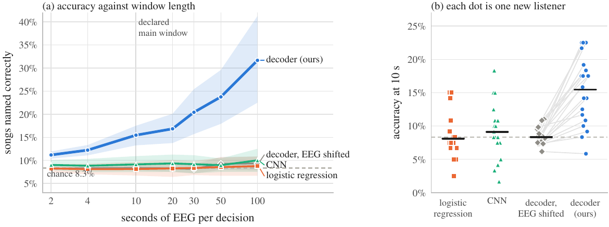
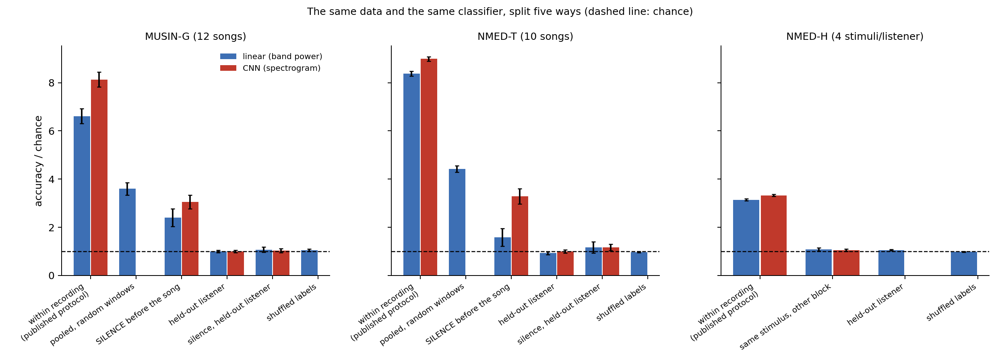
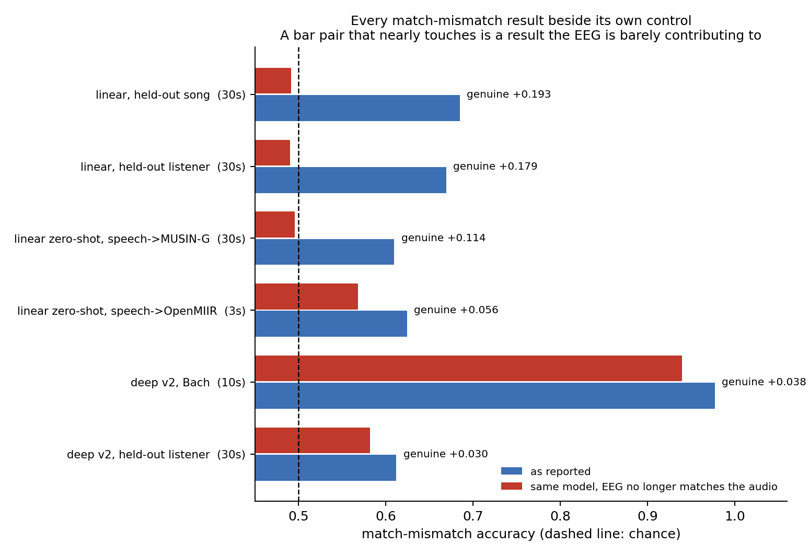
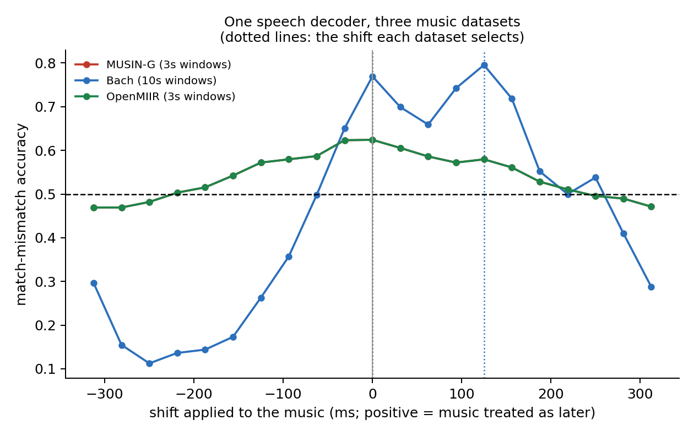

# eg606: which song is a new listener hearing?

From EEG recorded while someone listens to music, can we tell which of 12 songs they are hearing,
for a listener the model has never seen? This repository holds the full pipeline: dataset
acquisition, preprocessing, the decoder, the baselines, and the controls that test whether a result
comes from the music.

Course project for ES 606 (Computational Neuroscience), IIT Gandhinagar.

## Result: naming the song for a new listener

On [MUSIN-G](https://openneuro.org/datasets/ds003774) (20 listeners, 12 songs, each heard once),
song classifiers fall to chance (8.3%) when the test listener is excluded from training. Each song is
heard once, so they learn the recording instead of the music (see [Earlier analyses](#earlier-analyses)).

The decoder here maps EEG to the music instead:

1. A ridge regression, trained on the other 19 listeners, reconstructs the song's **note-onset
   curve** (spectral flux of the audio, 0-4 kHz) from 0-500 ms of EEG after each moment.
2. The reconstruction is correlated with the onset curve of each of the 12 songs.
3. The best-correlated song is the answer. The song label is never a training target.



Accuracy (%) for new listeners, mean over 20 leave-one-listener-out folds. Chance is 8.3%. The 10 s
window was declared as the main one before any result.

| model | 2 s | 10 s | 30 s | first 100 s of the song |
|---|---|---|---|---|
| **onset decoder** | **11.2** | **15.5** | **20.4** | **31.7** (76 of 240) |
| same decoder, EEG shifted in time (control) | 8.2 | 8.4 | 8.1 | 9.3 |
| logistic regression on band power | 8.3 | 8.1 | 8.3 | 8.7 |
| CNN on spectrograms (GuessTheMusic-style) | 9.0 | 9.1 | 9.2 | 10.0 |
| onset decoder, new listener, no EEG of the test song in training | 10.3 | 13.4 | 17.1 | 26.2 |

At 10 s the decoder beats chance for 18 of 20 listeners (+7.1 points, 95% CI 4.9-9.2,
q = 6e-5) and its own time-shift control for 19 of 20. Given the first 100 s of a song it is right
in 76 of 240 trials: 31.7% at the listener level (95% CI 22.1-41.7%), above chance for 16 of 20
listeners (sign-flip p = 1e-4). Songs last 100-133 s; scoring uses the first 100 s so that all 12
candidates exist at every moment.

In the last row, every EEG recording of the test song is also removed from training. The song's
audio stays among the 12 candidates; only its EEG is withheld. A classifier cannot do this, because
it can only answer with songs it has training EEG for.

How much of each signal the decoder needs (10 s):

| change | accuracy |
|---|---|
| onset curve from audio below 0.5 / 1 / 2 / 4 kHz | 9.9 / 12.6 / 14.2 / 15.5% |
| loudness envelope instead of onsets | 12.0% |
| 8 band-wise onset curves instead of one | 15.2% |
| EEG at 128 Hz instead of 64 Hz (0.5-32 Hz) | 15.9% |
| EEG 32-45 Hz amplitude envelope alone | 7.7% (chance) |

Keeping the music's higher sound frequencies helps (4 vs 0.5 kHz: +5.6 points, q = 4e-4);
keeping more of the EEG does not. All 11 declared comparisons, with intervals and corrected q values,
are written by `tools/report_newlistener.py`.

### Reproduce

```bash
python -m eg606.prep.musin_g --subjects all --clean basic          # 109 channels, 0.5-32 Hz, 64 Hz
python -m eg606.eval.newlistener --variant basic --splits loso,loso_song \
       --lambdas 3,11,17 --out results/newlistener/decoder_basic_lam11.json
python -m eg606.eval.newlistener_baselines --model logreg --out results/newlistener/logreg_basic.json
python -m eg606.eval.newlistener_baselines --model cnn --out results/newlistener/cnn_basic.json
python tools/report_newlistener.py                                  # tables and declared tests
```

Every run used in the results is listed in `configs/jobs_newlistener_{a,b,c}.txt`;
`scripts/submit_newlistener.sh` submits them as Slurm arrays.

## Earlier analyses

These come from the first phase of the project. They explain why the final task holds out whole
listeners and why every result is reported beside a control.

### 1. The usual protocol measures the recording, not the music

Published EEG music-identification results are usually obtained by splitting *one continuous
recording* into training and test windows. Reproducing that protocol across three public datasets
shows what it measures:



| dataset | chance | within recording | on **silence** | same stimulus, other block | held-out listener |
|---|---|---|---|---|---|
| MUSIN-G (12 songs, n=20) | .083 | **.551 (6.6×)** | .200 (2.4×) | n/a | .083 (1.0×) |
| NMED-T (10 songs, n=20) | .100 | **.838 (8.4×)** | .159 (1.6×) | n/a | .093 (0.9×) |
| NMED-H (4 stimuli/listener, n=48) | .250 | **.785 (3.1×)** | n/a | **.271 (1.1×)** | .264 (1.1×) |

The classifier "identifies" songs from the **silence before they start**, where no music is playing.
NMED-H says the same thing from the other side: hold the stimulus fixed and change only the
recording block, and 51 points of accuracy disappear. Held-out listeners sit at chance everywhere.

A *stronger* model makes this worse, not better. A spectrogram CNN reaches 8.1× chance within a
recording and reads 3.0× from silence, while generalising to a new listener exactly as badly.
Capacity buys leakage, not generalisation.

### 2. The time-locked alternative needs a control of its own

A natural alternative, used widely for speech, is a time-locked **match–mismatch** task: given EEG and two candidate audio
excerpts (the true one, and an imposter from the same song a second later), decide which produced
it. Both candidates share the recording, so slow drift cannot separate them. Chance is 50%.

That task can also be solved without reading the EEG at all. The test is a **derangement control**:
pair every audio target with a *different* trial's EEG, change nothing else, and score again.



| result | window | as reported | control | **genuine** |
|---|---|---|---|---|
| linear decoder, held-out listener | 30 s | 0.669 | **0.490** | **+0.179** |
| linear decoder, held-out song | 30 s | 0.685 | **0.492** | **+0.193** |
| linear, zero-shot speech → music | 30 s | 0.610 | 0.502 | +0.108 |
| linear, zero-shot speech → OpenMIIR | 3 s | 0.624 | 0.592 | +0.032 |
| contrastive model, held-out listener | 30 s | 0.618 | 0.584 | +0.034 (n.s.) |
| contrastive model, Bach | 10 s | 0.987 | **0.961** | +0.026 |

Two things leak, and scoring each pair from the audio alone, with no EEG at all, shows both. First,
the imposter always comes *after* the true window, and these songs get busier as they go, so the true
excerpt is the quieter one in 69% of pairs at 30 s. A scorer that responds to level can win without
the EEG; the contrastive model does, and the correlation-based linear decoder cannot. Second, short
trials leak: a 28 s Bach trial yields exactly one pair at 10 s, and there the control reaches 0.961
even with EEG from a different melody. Short OpenMIIR fragments catch the linear decoder the same
way (control 0.592 at 3 s).

The linear decoder passes both splits with its control at chance. The contrastive model does not
survive correction (q = 0.062) and is reported here as a negative result.

### 3. Cross-dataset timing



A decoder trained on **speech** transfers to music, but only when the two datasets agree about when
the sound began. MUSIN-G's event markers lag its audio by about **62 ms**, the same estimate in
every frequency band tested, which is what a fixed delay in a recording chain looks like and a
neural latency difference is not. OpenMIIR, whose authors recorded a dedicated audio-onset marker
and corrected for it, needs **0 ms** under the identical analysis, and its own measured
trigger-to-audio latency is 11.7 ms.

## Layout

```
src/eg606/
  data/download/   dataset downloaders (stdlib only), resumable and size-verified
  data/import_local.py  install datasets that block scripted download (Dryad)
  prep/            preprocessing per dataset -> 64 Hz epochs aligned to audio features
  audio/           envelope and onset (spectral flux) features, one definition for all datasets
  eval/            new-listener song ID (newlistener*.py), protocol comparison, match-mismatch,
                   transfer, latency analysis
  models/          contrastive EEG-audio model; VLAAI zero-shot wrapper
  train/           training loop and cross-validation (by listener, by song, or both)
scripts/           server sync, Slurm templates, publishing
tools/             one-off inspection scripts, kept because they document how facts were established
configs/           job configurations
```

## Getting the data

```bash
python -m eg606.data.download all --status     # what is present and what is missing
python -m eg606.data.download musin_g          # resumable; rerun to continue
python -m eg606.data.import_local --list       # datasets needing a browser download
```

| Dataset | Content | Audio |
|---|---|---|
| [MUSIN-G](https://openneuro.org/datasets/ds003774) | 20 listeners, 12 songs, 128-ch EGI | included |
| [SparrKULee](https://rdr.kuleuven.be/dataset.xhtml?persistentId=doi:10.48804/K3VSND) | 85 listeners, 168 h speech, 64-ch BioSemi | included |
| [Bach: music of silence](https://datadryad.org/dataset/doi:10.5061/dryad.dbrv15f0j) | 21 musicians, 4 melodies × 11 repeats | included |
| [NMED-T](https://purl.stanford.edu/jn859kj8079) / [NMED-H](https://purl.stanford.edu/sd922db3535) | naturalistic music EEG, 20 / 48 listeners | metadata only |
| [OpenMIIR](https://github.com/sstober/openmiir) | 10 listeners, 12 fragments, 64-ch BioSemi | stimuli included; EEG by BitTorrent only |

Set `EG606_DATA` to choose where data lives (default: the NAS path in `eg606/paths.py`).

## Running the pipeline

```bash
python -m eg606.prep.musin_g --subjects all --clean basic          # preprocess
python -m eg606.prep.musin_g --subjects all --to-montage biosemi64 # shared montage for transfer
python -m eg606.prep.sparrkulee --subjects all
python -m eg606.prep.bach

python -m eg606.eval.protocol --variant basic --feature onset --splits naive,loso,song
python -m eg606.eval.songid --variant basic                        # the leakage figure
python -m eg606.eval.latency --band 4,8                            # response-latency analysis
python -m eg606.train.cv --dataset music --model v2 --cv 5 --cv-by song
```

`scripts/sync.sh` mirrors the code to compute servers and submits jobs (`push`, `sbatch`, `status`);
copy `scripts/servers.env.example` to `scripts/servers.env` with your own machines first.

## Requirements

Python 3.10+, NumPy/SciPy, MNE-Python, scikit-learn, PyTorch (CUDA optional), ONNX Runtime for the
VLAAI baseline. `pip install -e ".[prep,audio,train]"`.

## Credits

Datasets are the work of their authors (cited above); please follow their licences. VLAAI weights
come from [exporl/vlaai](https://github.com/exporl/vlaai). The match–mismatch formulation follows the
auditory-EEG literature (Accou et al.; the ICASSP Auditory EEG Challenges).
